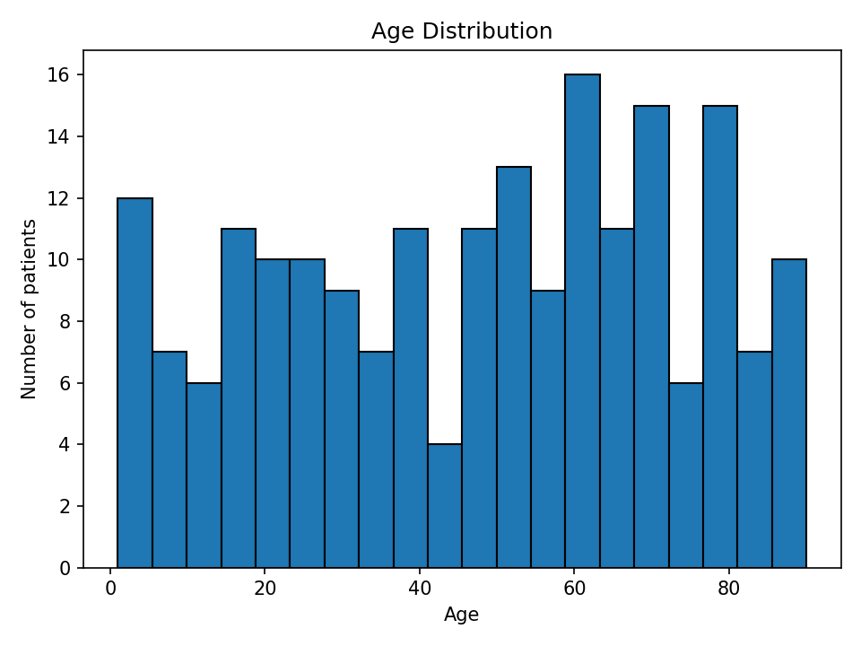
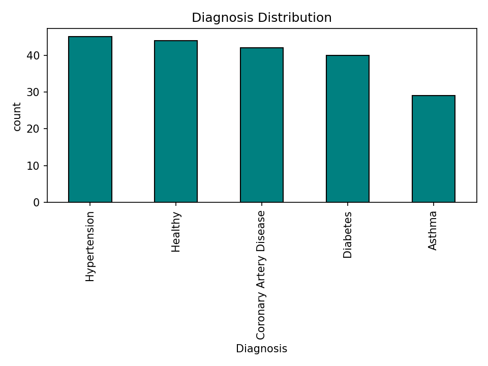
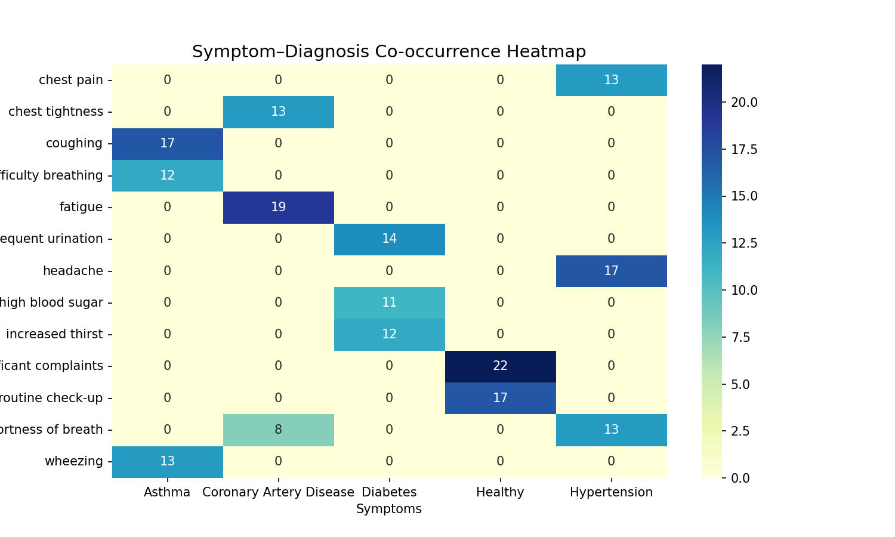

# Medical Report Assistant (GenAI Project)


An AI-powered assistant that summarizes clinical report text into a short,
plain-language description. A **t5-small** model is fine-tuned on
**[MTSamples](https://www.kaggle.com/datasets/tboyle10/medicaltranscriptions)**,
a real, publicly available, de-identified dataset of about 5,000 medical
transcription notes, and served through a Streamlit app.

> Educational project - not medical advice, and not for use on real patient
> data. All personally-identifiable data used or generated here is either
> synthetic (Faker-generated) or already public/de-identified (MTSamples,
> PubMed). No real PHI is stored or processed anywhere in this repo.

---

## Project Structure

```
medical-report-assistance/
  data/
    raw/             Synthetic data (demographics, EHR) + real data (MTSamples, PubMed sample)
    processed/       Cleaned/tokenized text
    features/        TF-IDF and other extracted features
  notebooks/          EDA, preprocessing, and text-analytics notebooks
  src/
    data_generation/ Synthetic demographics/EHR/clinical-note generators (Faker)
    data_ingestion/  Downloads + caches the real MTSamples and PubMed datasets
    preprocessing/   Shared text-cleaning pipeline (tokenize, stopwords, lemmatize)
    modeling/        Fine-tunes and evaluates the summarization model
    inference/       Inference wrapper used by the app and tests
  app/
    main.py           Streamlit app
    assets/eda/       Saved EDA figures used below
  models/summarizer/  Fine-tuned model output (weights gitignored, regenerate locally)
  tests/               pytest unit tests
  .github/workflows/ci.yml  GitHub Actions: runs the test suite on every push/PR
  Dockerfile
  requirements.txt
  README.md
```

---

## Datasets

| Dataset | Real or synthetic | Used for |
|---|---|---|
| `patient_demographic.csv`, `patient_ehr.csv` | Synthetic (Faker) | EDA practice, HIPAA-safe demo data |
| `clinical_notes.csv` | Synthetic (template-generated) | Early text-preprocessing practice |
| `mtsamples.csv` | Real, de-identified, public | Fine-tuning + primary evaluation of the summarizer (`transcription` -> `description`) |
| `pubmed_summarization_sample.csv` | Real, public (PubMed abstracts) | Out-of-domain evaluation - checks the summarizer is not just memorizing MTSamples' style |

The synthetic generators under `src/data_generation/` are kept because they
are useful for HIPAA-safe experimentation, but the model itself is trained
and evaluated only on the real datasets above.

---

## Summarization Model

- Base model: `t5-small` (about 60M params) - small enough to fine-tune on a
  single consumer GPU (tested on an NVIDIA GTX 1650 Ti, 4GB VRAM) in under an
  hour, rather than requiring a datacenter GPU.
- Fine-tuning task: `transcription -> description` on MTSamples (real
  clinical note -> real one-line human-written summary).
- Inputs are truncated to 512 tokens and outputs to 64 tokens - long
  transcriptions get cut off. This is a known limitation of using a small
  model rather than something like a long-context clinical LLM.

### Reproducing it

```bash
python -m src.data_ingestion.load_mtsamples     # caches data/raw/mtsamples.csv
python -m src.data_ingestion.load_pubmed        # caches data/raw/pubmed_summarization_sample.csv
python -m src.modeling.train_summarizer         # fine-tunes t5-small, saves to models/summarizer/final
python -m src.modeling.evaluate_summarizer      # ROUGE comparison: pretrained baseline vs. fine-tuned
```

If no fine-tuned model is present, the app and inference code automatically
fall back to the plain pretrained `t5-small`, so everything still runs
end-to-end without training first - just with weaker summaries.

### Results (ROUGE, fine-tuned vs. pretrained baseline)

Generated by `src/modeling/evaluate_summarizer.py` on held-out real data (200
MTSamples test examples, 100 PubMed sample examples); see
`models/summarizer/eval_results.csv` for the exact run.

| Model | Dataset | ROUGE-1 | ROUGE-2 | ROUGE-L |
|---|---|---|---|---|
| Pretrained t5-small (baseline) | MTSamples (in-domain) | 0.2305 | 0.1329 | 0.2039 |
| Fine-tuned t5-small (ours) | MTSamples (in-domain) | 0.6306 | 0.5675 | 0.6175 |
| Pretrained t5-small (baseline) | PubMed (out-of-domain) | 0.1757 | 0.0584 | 0.1240 |
| Fine-tuned t5-small (ours) | PubMed (out-of-domain) | 0.1403 | 0.0512 | 0.1064 |

Fine-tuning nearly tripled ROUGE-1 on the in-domain MTSamples task (0.23 -> 0.63),
which is expected since it is now directly trained on that exact
transcription -> description mapping. It slightly *reduced* ROUGE on the
out-of-domain PubMed sample (0.176 -> 0.140): the model learned to produce
short, clinical-style one-liners, which match MTSamples' real summary style
but match PubMed's longer academic-abstract style a bit less well than the
general-purpose pretrained baseline. That is a real, honest generalization
trade-off of fine-tuning on a narrow domain, not a bug.

---

## How to Run Locally

1. Clone the repo:
   ```bash
   git clone https://github.com/hineshpatel-ds/medical-report-assistance.git
   cd medical-report-assistance
   ```

2. Create a virtual environment:
   ```bash
   python -m venv .venv
   source .venv/bin/activate       # Linux/Mac
   .venv\Scripts\activate          # Windows
   ```

3. Install dependencies:
   ```bash
   pip install -r requirements.txt
   python -m nltk.downloader stopwords wordnet omw-1.4
   ```
   For CUDA GPU support, install PyTorch from the CUDA index instead - see
   the comment at the bottom of `requirements.txt`.

4. (Optional) Fine-tune the summarizer on real data - see "Reproducing it"
   above. Skip this to run with the pretrained baseline.

5. Run the app:
   ```bash
   streamlit run app/main.py
   ```

6. Run the tests:
   ```bash
   pytest                 # fast tests only
   pytest -m slow         # include the real-model integration test
   ```

### Docker

```bash
docker build -t medical-report-assistant .
docker run -p 8501:8501 medical-report-assistant
```

---

## Tech Stack
- Python 3.12
- Pandas, NumPy, Matplotlib, Seaborn - data analysis & EDA
- NLTK, scikit-learn, gensim - text preprocessing & TF-IDF
- Hugging Face Transformers, Datasets, PyTorch - fine-tuning and inference
- Streamlit - web app
- pytest - testing
- Docker, GitHub Actions - containerization & CI

---

## Roadmap
- [x] Generate synthetic medical data (HIPAA/GDPR-safe)
- [x] Perform EDA & preprocessing
- [x] Ingest real, de-identified medical text data (MTSamples, PubMed)
- [x] Fine-tune an LLM for text summarization on real data
- [x] Build a user-facing app (Streamlit)
- [x] Add automated tests + CI
- [x] Containerize with Docker
- [ ] Deploy to the cloud (AWS/GCP)

---

## Exploratory Data Analysis (EDA) Preview

To ensure realism and usability of the synthetic medical datasets, we
performed detailed EDA. Below are some example visualizations:

### Demographics


### EHR (Electronic Health Records)


### Symptom-Diagnosis Relationships
We analyzed how symptoms co-occur with diagnoses. Example visualization below:



More plots (gender, blood group, medications, heart rate, glucose) are
available in the `notebooks/` folder.

---

## Author

Hinesh Patel
Master of Applied Computer Science, Dalhousie University
Aspiring Data Scientist - GenAI & Healthcare Enthusiast

[LinkedIn](https://linkedin.com) | [GitHub](https://github.com/hineshpatel-ds)
